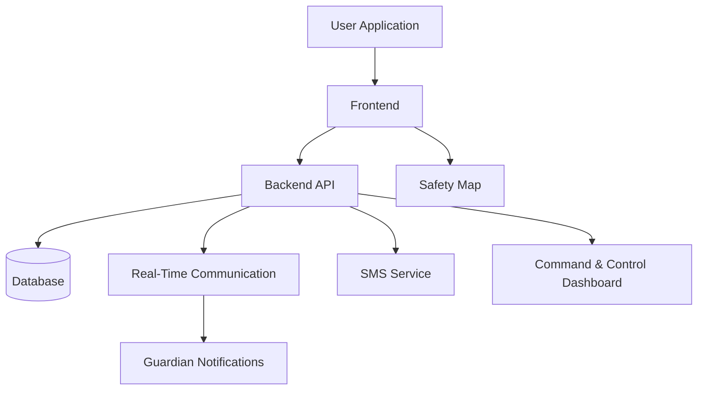

### 🚀 Team Spearhead Squadron

**A women-first safety platform designed to make everyday travel safer.**

[Repository](https://github.com/SujanKhan18/spearhead-squadron-HK26-0036)

---

## 1. Problem Statement

Personal safety remains a major concern for individuals traveling alone, especially at night or in unfamiliar areas. In emergencies, people may be unable to make phone calls, share their location, or contact trusted individuals quickly. Existing safety applications often depend on manual activation and may not provide sufficient context to support a rapid response. 

**Challenge:**Develop an intelligent personal safety application that enables users to trigger an emergency alert discreetly, share their live location with trusted contacts, and access nearby emergency services. The system should incorporate optional voice-activated SOS, location-based risk information, and an automated escalation mechanism when a user fails to respond to a safety check-in. 

## 2. Our Solution

**SAFESPHERE** brings key personal-safety tools together in one platform. It is designed to help users raise an SOS alert, share their location with trusted guardians, discover nearby safety-related places, and support incident monitoring through a command-centre dashboard.

The platform brings together multiple ways to initiate an alert, real-time communication, location-based information, and a central view of incidents. Its aim is to make it easier for users and their trusted support network to respond when help may be needed.

> **Our goal:** make safety support more accessible, connected, and responsive—so users can travel with greater confidence.

## 3. Key Features

| Feature | What it does |
|---|---|
| **SOS Alerts** | Lets a user trigger an emergency alert from the application. |
| **Voice-Triggered SOS** | Supports hands-free SOS activation through configured distress phrases, with a short cancellation countdown. |
| **Threat Monitoring** | Combines motion, audio-level, and route-deviation signals into a threat indicator intended to support safety check-ins and escalation. |
| **Live Safety Map** | Displays safety-related points of interest such as police stations, hospitals, and safe zones. |
| **Guardian Network** | Lets users maintain trusted emergency contacts and share alert information with them. |
| **Real-Time Updates** | Uses live event communication to share SOS and incident updates with connected clients. |
| **Command & Control Dashboard** | Provides an incident overview for operators, including incident status updates. |
| **SMS Alert Integration** | Supports SMS notifications to guardians through a configured messaging provider. |
| **Account & Access Management** | Provides account authentication and access-controlled application areas. |
| **Responsive Interface** | Designed to support use across desktop and mobile screen sizes. |

*Feature availability may depend on configuration, connectivity, permissions, and external service credentials. SAFESPHERE should complement—not replace—local emergency services.*

## 4. How SAFESPHERE Works

1. **The user requests help** by triggering SOS manually or through a supported voice or threat-monitoring flow.
2. **The application processes the alert** through the backend, which handles authentication and incident logic.
3. **The alert is recorded** and associated information, such as the user's location and available guardian details, is processed.
4. **Trusted contacts are notified** through the available real-time alert flow and, when configured, SMS.
5. **The command dashboard receives incident updates** so an authorized operator can review and update the incident status.

## 5. Project Structure

SAFESPHERE is organized into two main application layers, supported by a database and external integrations.

### Frontend — User Experience

The frontend contains the screens and interactions used by people using SAFESPHERE. Its main areas include:

- **Authentication:** registration, login, and account access.
- **Safety workspace:** SOS controls and threat-monitoring interface.
- **Map experience:** location-based safety points and incident markers.
- **Guardian management:** trusted contact information.
- **Command dashboard:** incident overview and status-management interface.
- **Supporting pages:** wellness information, current affairs, and user settings.

### Backend — Application Services

The backend coordinates application logic and communication between the frontend, database, and integrations. Its responsibilities include:

- Account authentication and protected access.
- SOS creation, cancellation, and incident-status handling.
- Guardian and location-related operations.
- Safety-map data access.
- Real-time event delivery.
- Subscription and payment-related workflows where configured.
- External SMS notifications where credentials are provided.

### Data Layer

The database stores the application information required by supported workflows, such as user accounts, guardian relationships, SOS incidents, safe-place records, and subscription information.

### Integrations

- **Real-time communication:** Socket.IO.
- **Maps:** Leaflet and OpenStreetMap.
- **SMS notifications:** Twilio, when configured.
- **Voice recognition:** browser Web Speech API support.
- **Authentication:** JSON Web Token (JWT)-based access control.

## 6. Technology Stack

| Layer | Technologies | Purpose |
|---|---|---|
| **Frontend** | React, Vite, JavaScript, Tailwind CSS | User interface and responsive application screens |
| **Routing** | React Router | Navigation between application areas |
| **Backend** | Node.js, Express.js | API endpoints and application logic |
| **Database** | MongoDB, Mongoose | Persistent application data |
| **Real-Time Communication** | Socket.IO | Live SOS and incident updates |
| **Maps** | Leaflet, OpenStreetMap | Map display and safety-related locations |
| **Voice Interaction** | Web Speech API | Voice-triggered SOS support in compatible browsers |
| **Notifications** | Twilio integration | SMS alerts when configured |
| **Authentication** | JWT | Authenticated access to protected features |

## 7. Intended Impact

SAFESPHERE is designed to support:

- **Faster access to help** through multiple SOS activation options.
- **Better communication** between users and their trusted guardians.
- **Location awareness** through a map of relevant safety-related places.
- **Centralized incident visibility** through a command-and-control dashboard.
- **More connected safety workflows** by bringing several tools into one platform.

These are the project's intended benefits; actual outcomes depend on correct configuration, testing, connectivity, and the availability of relevant services.

## 8. Team

### 🚀 Team Spearhead Squadron

*Four members working toward one safety-focused solution.*

| Team Member | Contribution Area |
|---|---|
| **MOHD Jasim Husain Ali Khan** | Frontend and user experience |
| **Mohd Nasir** | Backend and database |
| **Mohd Moshin** | SOS features and integrations |
| **Suzain Khan** | Maps, testing, and documentation |

*The contribution areas above are a suggested division based on the project's components. Update them if the team's actual responsibilities differ.*

## 9. Project Repository

**GitHub:** [SujanKhan18/spearhead-squadron-HK26-0036](https://github.com/SujanKhan18/spearhead-squadron-HK26-0036)

This repository contains the SAFESPHERE project developed by Team Spearhead Squadron.

## 10. Future Improvements

- Improve reliability in low-connectivity conditions.
- Expand language and accessibility support.
- Strengthen validation and testing of threat-monitoring flows.
- Improve community verification of safety-related locations.
- Explore native mobile capabilities for background location and notifications.
- Continue improving privacy, security, and incident-response workflows.

---

**SAFESPHERE — Safer Journeys. Stronger Support.**

Built by **Team Spearhead Squadron** 💜
